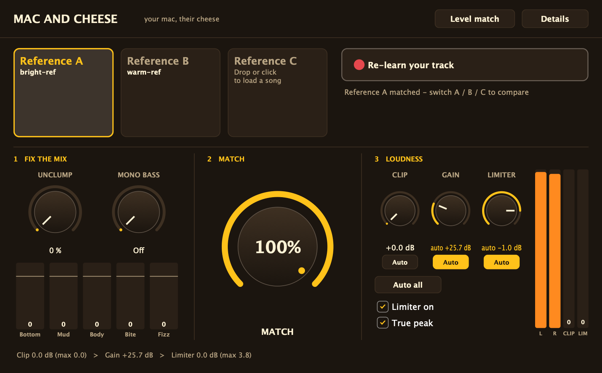

# Mac and Cheese

**Your mac, their cheese.** Your track is the mac; a great-sounding reference song is the cheese. Mac and Cheese pours the reference's tone and loudness over your track, live in your DAW.

A free VST3 plugin for reference mastering, based on [Matchering](https://github.com/sergree/matchering), built in public.



## ⬇ Download

### [Download the VST3 plugin for macOS](https://github.com/SlapBackers/MacAndCheese/releases/latest/download/Mac-and-Cheese-VST3-plugin-macOS.zip)

Always the latest version, Apple Silicon and Intel. Windows and Linux are coming in v2.2.3.

1. Unzip it: you get **`Mac and Cheese.vst3`**.
2. Move it to `~/Library/Audio/Plug-Ins/VST3` (in Finder: Go → Go to Folder…, paste the path).
3. Rescan plugins in your DAW.

If your DAW doesn't list it (macOS blocks plugins that Apple hasn't notarised), run this once in Terminal:

```bash
xattr -dr com.apple.quarantine "$HOME/Library/Audio/Plug-Ins/VST3/Mac and Cheese.vst3"
```

What changed: [CHANGELOG](CHANGELOG.md) · all versions: [Releases](https://github.com/SlapBackers/MacAndCheese/releases) · what's next: [ROADMAP](ROADMAP.md)

## How to use it

1. **Drop up to 3 references** (great-sounding mastered songs) into **A / B / C**.
2. **Press Learn and play your track**, loudest part included. When the button says "enough", press Stop.
3. **Switch A / B / C** to compare. Everything is live and non-destructive.

The plugin follows the signal in three steps:

| Step | Controls | What it does |
|---|---|---|
| **1 Fix the mix** | Unclump, Mono bass | **Unclump** evens out build-ups that come and go (mud blooming in a chorus, harsh cymbal hits) compared with the reference, in 5 bands, mid and side separately. **Mono bass** makes the low end mono below a chosen frequency. |
| **2 Match** | Match | The reference's tone and loudness, computed on the fixed mix. 0 % = your mix, 100 % = fully matched. |
| **3 Loudness** | Clip → Gain → Limiter | Each knob is **Auto** or manual. Auto clip shaves the peaks, auto gain matches the reference's loudness, auto limiter holds −1 dBTP. With the limiter off, the plugin tells you how much to push into your own limiter. |

- **Level match**: hear the result at your track's own loudness, the fair comparison (louder always sounds better).
- **Details**: EQ curve, Linear / Natural EQ, Mid / Side EQ, EQ smoothing, Max EQ, Unclump per band (50 % = match the reference, up to 2×), Allow boosts.

Re-learn after big mix changes. References and the learned match are saved with your project; loading a *new* reference after reopening needs a new Learn.

## Under the hood

A real-time C++ port of Matchering's processing:

| Matchering | Mac and Cheese |
|---|---|
| Loudness match on the loudest ~15 s pieces | same, measured during Learn |
| Matching EQ from averaged spectra, smoothed (LOWESS) | same, as a linear-phase FIR on Mid and Side, updated while you turn the knobs |
| RMS correction passes | same |
| "Hyrax" brickwall limiter | real-time port with ~5 ms lookahead and 4× true-peak detection |
| — | Unclump: 5-band dynamic match against the reference |
| — | Clipper before the limiter: [ClipOnly2](https://github.com/airwindows/airwindows) by Airwindows |

Latency is reported to the host: about 95 ms at 48 kHz in Linear mode, about 10 ms in Natural mode.

## Build from source

Needs CMake ≥ 3.22 and the Xcode command line tools.

```bash
git clone --recurse-submodules https://github.com/SlapBackers/MacAndCheese.git
cd MacAndCheese
cmake -B build -DCMAKE_BUILD_TYPE=Release
cmake --build build --target MacAndCheese_VST3 -j
```

The plugin lands in `build/MacAndCheese_artefacts/Release/VST3/Mac and Cheese.vst3`.

Tests (matching maths, then the full plugin flow with GUI renders):

```bash
cmake --build build --target MacAndCheeseCLI MacAndCheeseFlowTest -j
./build/MacAndCheeseCLI_artefacts/Release/MacAndCheeseCLI selftest
./build/MacAndCheeseFlowTest_artefacts/Release/MacAndCheeseFlowTest.app/Contents/MacOS/MacAndCheeseFlowTest /tmp/mm
```

## Credits & license

- Matching algorithm: [Matchering](https://github.com/sergree/matchering) © 2016–2022 Sergree, GPLv3, ported to C++ for real time. Mac and Cheese is a separate project, not affiliated with Matchering (see [NOTICE](NOTICE)).
- Clipper: [ClipOnly2](https://github.com/airwindows/airwindows) by Chris Johnson / Airwindows, MIT licence.
- Framework: [JUCE](https://juce.com).

Mac and Cheese is free software under the **GNU GPL v3** (see [LICENSE](LICENSE)). Formerly called MatchMaster. Suggestions welcome: [open an issue](https://github.com/SlapBackers/MacAndCheese/issues).
